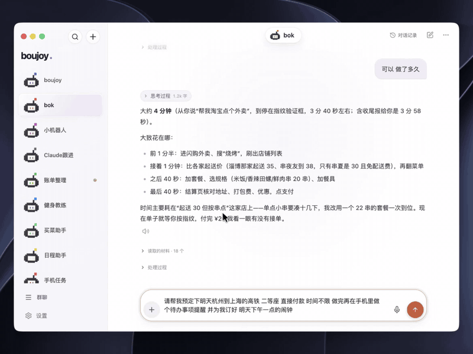

# Boujoy Personal Agent

[English](README.md) · [简体中文](README.zh-CN.md)

Ask once, and watch your Android work through the steps. Boujoy runs on your Mac, reads the paired phone’s screen and operates its apps. Ask it to compare two listings and it can bring the prices and sizes back to chat. You decide when to take over.

### Try a read-only task

> Find two options for the same item in my shopping app. Compare the displayed prices and sizes, tell me where you saw them, and stop before checkout.

The agent can open the app, inspect successive screens and report what it found in the conversation. If a login or another step needs your attention, take over on the phone. The example uses ordinary language. Results depend on the app, permissions and available screen information.

**Device support.** Use the main display of a paired Android 13+ phone. The phone needs the supported Phone Use client and the permissions it requests during setup.

## Recorded demos

These recordings from an earlier build show the desktop agent and phone workflow.

**Desktop agent** · [MP4](docs/demos/boujoy-agents.mp4)



**Android phone** · [MP4](docs/demos/boujoy-device-demo.mp4)


## What changed in 1.0.52

- Sending a message immediately places it at the bottom of the current chat. Delivery receipts reconcile by ID, and a failed send preserves the draft in its conversation. The connection indicator reflects what the phone observes.
- Each screen observation still captures fresh frames. Consecutive byte-identical images within an observation reuse successful local OCR. Changed frames are recognized again. Task synchronization scans receipts only when an outcome needs verification.
- Identical phone screenshots in a model request share one original. Adjacent native page trees can reference identical lines while retaining changes such as prices. Four repeated screenshots reduced a synthetic request from 405 KB to 104 KB. End-to-end time depends on the device, network and model.

## Run from source

Use an Apple Silicon Mac, Node.js 24+ and Python 3.10+. Run the following commands from the repository root. Setup downloads dependencies. Configure your own model credentials in the local app.

```sh
npm ci
npm run setup
python3 scripts/prepare-phone-use.py --include-apk
npm start
```

Open `http://127.0.0.1:18891`. Use Settings to select a device and configure your model and pairing relay with your own credentials. Build and test the Android app with `python3 scripts/build-android.py --test`. Run `npm test` for the backend suite and `node scripts/verify-distribution.mjs` to verify the edition. See the [detailed build guide in Chinese](BUILD.zh-CN.md).

## Reproduce the request-size comparison

Compare the serialized request size against the original public 52 source using synthetic screenshots offline.

```sh
git worktree add --detach ../boujoy-phone-use-baseline v1.0.52-base
node scripts/bench-model-frame-context.mjs ../boujoy-phone-use-baseline evidence/vision-fixtures
```

Original Boujoy code is available under the [MIT License](LICENSE). Dependencies, fonts, icons and bundled upstream sources retain their respective licenses. See [third-party notices](THIRD_PARTY_NOTICES.md).
