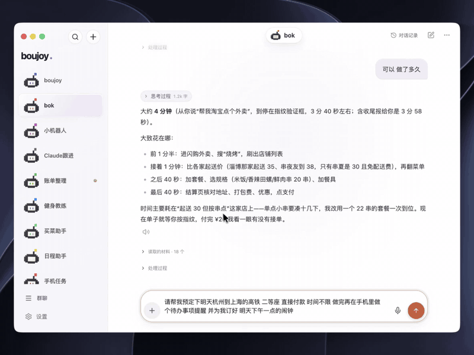

# Boujoy Personal Agent

[English](README.md) · [简体中文](README.zh-CN.md)

你说一句「帮我看看哪款更划算」，Boujoy 就能打开手机上的 App，翻过几个页面，把看到的价格和规格带回聊天。Mac 负责规划，Android 负责操作，每一步都可以查看，什么时候接手由你决定。

### 第一次可以试什么

> 帮我在购物 App 里找同一件商品的两个选项，对比页面上显示的价格和规格，告诉我在哪里看到的，到结算前停下。

助理可以打开应用、读取连续几个页面，再把结果发回对话。碰到登录或其他需要本人处理的步骤时，你可以直接在手机上接手。不同 App 的界面、已授予的权限和页面可读信息会影响结果。

**设备要求。** 通用版通过已配对的 Android 13+ 手机主屏操作。按配置向导准备 Phone Use 客户端，并在手机上授予所需权限。

## 录屏演示

早期版本的实录，展示桌面任务调度和手机操作。

**桌面任务调度** · [MP4](docs/demos/boujoy-agents.mp4)



**手机实机操作** · [MP4](docs/demos/boujoy-device-demo.mp4)


## 52 的更新

- 手机上点击发送后，消息立即出现在当前对话底部。回执到达后按 ID 合并；发送失败保留对应对话的草稿。连接栏显示手机实际观测到的状态。
- 读屏仍获取新帧。同次观察中，连续两张截图的完整编码相同就复用成功的本地 OCR 结果，画面变化时重新识别。任务同步只为确实待核实的结果扫描回执。
- 模型请求只发送一次可确认重复的手机截图。相邻同窗口页面可引用完全相同的文本行，两个不同的价格与画面都保留。四张相同截图的合成请求从 405 KB 降至 104 KB；真实任务耗时取决于设备、网络和模型。

## 从源码启动

使用 Apple Silicon Mac、Node.js 24+ 和 Python 3.10+。在仓库根目录执行以下命令。下载的工具和模型服务分别需要网络，模型凭证由使用者配置。

```sh
npm ci
npm run setup
python3 scripts/prepare-phone-use.py --include-apk
npm start
```

打开 `http://127.0.0.1:18891`。在设置中选择手机、配置模型和配对中继；请使用自己的服务器和账号。Android 源码构建命令为 `python3 scripts/build-android.py --test`。运行 `npm test` 和 `node scripts/verify-distribution.mjs` 可检查后端与发行身份。详见[完整构建指南](BUILD.zh-CN.md)。

## 复现请求体积对照

以下命令使用合成画面比较更新前后的请求字节数，全程离线。

```sh
git worktree add --detach ../boujoy-phone-use-baseline v1.0.52-base
node scripts/bench-model-frame-context.mjs ../boujoy-phone-use-baseline evidence/vision-fixtures
```

Boujoy 原创代码采用 [MIT 许可证](LICENSE)。依赖、字体、图标和随附源码各自的许可证见[第三方声明](THIRD_PARTY_NOTICES.md)。
